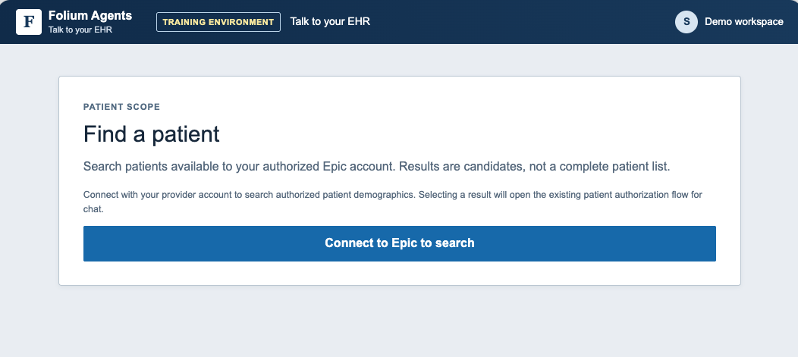
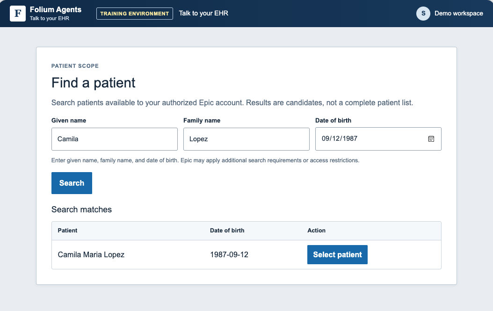

# Epic Chart Chat

## Overview

Epic is the first EHR connector for the provider-neutral Folium Agents chat. The integration uses SMART authorization and FHIR reads to support a locally run, synthetic-data workflow.

## Implemented

Patient Search and Chat are separate pages. Patient Search uses given name, family name, and date of birth, and requires the clinician to select a candidate explicitly. Search results are candidates, not a complete patient list; an empty result does not prove that no matching patient exists.

After selection, the app starts patient-scoped authorization for chat. The provider-level search grant is not reused for chart reads. Chat reads supported medication, allergy, condition, and demographic records for the selected patient.

The same patient-bound chat supports read-only claims searches. Results are checked against the selected patient, and incomplete retrieval is reported explicitly. An empty claims result is presented as no matching claims, not as a zero balance or payment status.

Answers cite returned evidence and report limitations. The app does not diagnose, recommend treatment, place orders, change the medical record, post payments, or infer internal payment or balance status from claim data.

## Boundaries and status

Epic integration is in progress. The target Epic app and clinician must be approved for patient search and the patient-scoped chart resources used by the workflow. Authorization support and populated chart or claims results must be verified in the target environment; capability metadata and offline tests do not establish live access.

The local workflow is for synthetic sandbox data and does not provide clinician identity authentication. Tokens remain server-side, patient context is checked for each read, and chat transcripts are not persisted. The provider-search token and patient-scoped chat authorization remain separate.

The app does not enumerate patients, present search as a roster, fall back to mock patient data, or perform financial actions. EOB data does not establish an internal billing ledger, payment posting, or outstanding balance.
